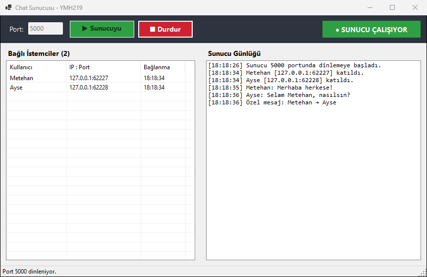
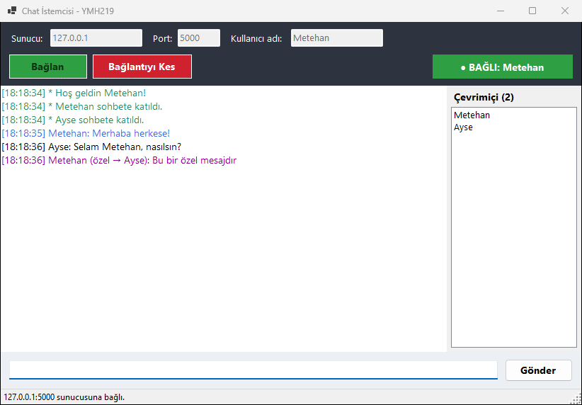
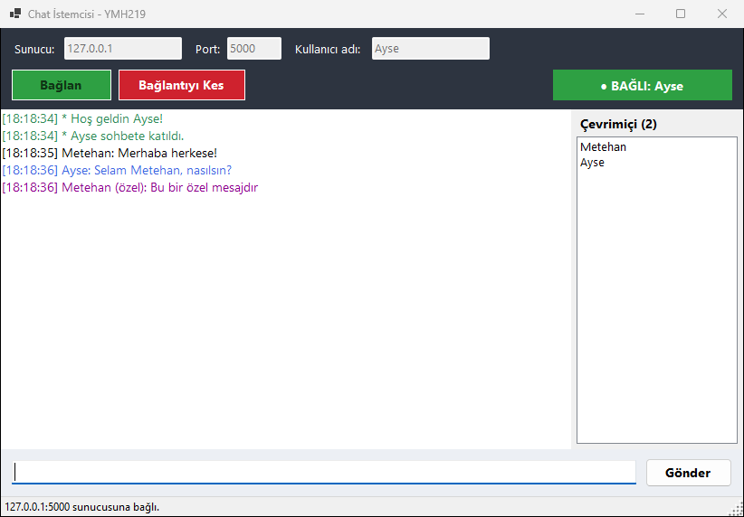

# YMH219-ChatApp

TCP/IP tabanlı **istemci-sunucu sohbet uygulaması** (C# / .NET Windows Forms). Aynı bilgisayarda veya yerel ağda birden fazla istemci aynı odada mesajlaşabilir. Nesne Tabanlı Programlama (YMH 219) dersi ek uygulama ödevidir.

## Kullanılan Teknolojiler
- C# 14 / .NET 10, Windows Forms
- `TcpListener` / `TcpClient`, `StreamReader` / `StreamWriter`
- `async` / `await`, `CancellationToken`, `SemaphoreSlim`
- Harici NuGet paketi yoktur

## Çözüm Yapısı
| Proje | Açıklama |
|---|---|
| `ChatApp.Common` | Ortak protokol (`Packet`, `PacketType`) ve doğrulama (`ChatDefaults`) |
| `ChatApp.Server` | `ChatServer`, `ClientSession` ve sunucu arayüzü |
| `ChatApp.Client` | `ChatClient` ve istemci arayüzü |

Protokol satır tabanlıdır: `TUR|alan1|alan2` (özel karakterler kaçışlanır).

## Kurulum ve Çalıştırma
1. Windows ve [.NET 10 SDK](https://dotnet.microsoft.com/download) gerekir.
2. `git clone https://github.com/MetehanSalihoglu/YMH219-ChatApp.git` ve `cd YMH219-ChatApp`
3. Sunucu: `dotnet run --project ChatApp.Server` → **Sunucuyu Başlat** (varsayılan port 5000)
4. İstemci (her biri ayrı terminalde, istediğiniz kadar): `dotnet run --project ChatApp.Client`
5. Sunucu adresi (aynı PC için `127.0.0.1`), port ve kullanıcı adı girip **Bağlan**'a basın.

Aynı ağdaki başka bir bilgisayardan bağlanmak için sunucu IP adresini girin ve güvenlik duvarında portu açın.

## Temel Özellikler
- Kullanıcı adı ile bağlanma (benzersiz ad zorunlu), **Bağlan / Mesaj Gönder / Bağlantıyı Kes**
- Gönderilen ve alınan mesajlar zaman bilgisiyle gösterilir
- Sunucu tarafında bağlı istemciler (kullanıcı, IP:port, bağlanma saati) ve günlük listelenir
- Bağlantı hataları (sunucu yok, zaman aşımı, kopma, kullanıcı adı çakışması) uygulamayı kapatmadan bildirilir
- İsteğe bağlı: birden fazla istemcinin aynı odada sohbeti, özel mesaj (`/w kullanıcı mesaj` veya listede çift tıklama), mesaj geçmişinin `%AppData%\YMH219-ChatApp\chat_history.txt` dosyasına kaydı

## Ekran Görüntüleri
| Sunucu | İstemci (Metehan) | İstemci (Ayse) |
|---|---|---|
|  |  |  |

## Bilinen Sınırlamalar / Geliştirme Notları
- İletişim şifrelenmez (ders amaçlı düz TCP).
- Sunucu yeniden başlatılırsa istemciler yeniden bağlanmalıdır.
- Mesaj geçmişi yalnızca sunucuda tutulur; yeni katılan kullanıcıya eski mesajlar gösterilmez.

## Öğrenci
Metehan Salihoğlu — 250542025
